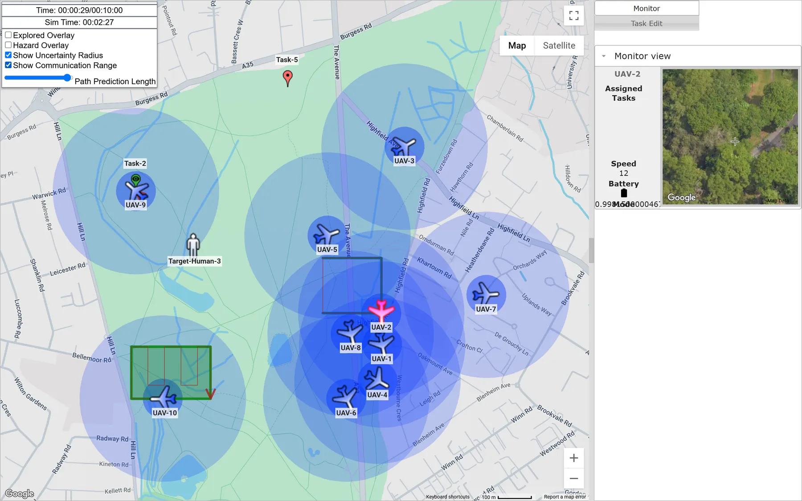

<p align="center">
  
</p>

<h1 align="center">HARIS Moongazer</h1>

<p align="center">
  <b>Human And Robot Interactive Swarm simulator</b><br>
  A browser-based platform for human–swarm interaction research.
</p>

<p align="center">
  <a href="https://williamhunt518.github.io/haris-moongazer/">Website and online demo</a> ·
  <a href="docs/getting-started.md">Getting started</a> ·
  <a href="docs/scenarios.md">Scenario reference</a> ·
  <a href="docs/architecture.md">Architecture</a> ·
  <a href="CONTRIBUTING.md">Contributing</a>
</p>

---

In HARIS, one operator supervises and tasks a simulated swarm of UAVs and ground vehicles over a live Google Map. Every interface feature (lenses, prediction panels, scan review, abstraction, the level of autonomy) is switched on or off per experiment in a JSON scenario file, so a study condition is a file rather than a code change. The server logs every operator action for analysis.

HARIS grew out of HutSim, the University of Southampton's human–agent task allocation simulator, and has been used in user studies and demos from 2021 to 2025.

**Moongazer** is the consolidated, maintained version: the features from the research branches on one branch (`moongazer`), a one-command Gradle build, Docker, CI, a launch page with a tile for each showcased feature, a refreshed "Modern" look next to the original "Classic" one, and an online demo that replays recorded runs in the real interface.



## Quick start

You need:

- a **JDK, 17 or newer**. Gradle downloads Java 21 for the build if you don't have it.
- a **Google Maps JavaScript API key**. Restrict it by HTTP referrer, for example to `http://localhost:44101/*`.
- optionally, **[PRISM 4.8](https://www.prismmodelchecker.org/)** for the live predictions in predictive fleet management.

```bash
git clone -b moongazer https://github.com/WilliamHunt518/haris-moongazer
cd haris-moongazer/server
export HARIS_MAPS_KEY=<your-key>     # Windows PowerShell: $env:HARIS_MAPS_KEY="<your-key>"
./gradlew run                        # Windows: gradlew.bat run
```

Then open <http://localhost:44101>. The launch page shows a tile for each feature, the sandbox, and a list of every scenario.

Prefer a file to an environment variable? Copy `server/config.example.properties` to `server/config.properties` (it is git-ignored) and set `maps.key=`. **Never commit a Maps key**: pages refer to it as `%HARIS_MAPS_KEY%` and the server fills it in as it serves them, and CI fails if a key appears in a tracked file.

With Docker instead:

```bash
cd server
HARIS_MAPS_KEY=<your-key> docker compose up --build
```

[Getting started](docs/getting-started.md) covers ports, PRISM, logs, participant sessions and troubleshooting.

## What you can try

Each tile on the launch page opens a scenario that shows one research feature. Tiles with study conditions let you pick the condition before launching.

| Tile | What it shows | Scenario files | From |
|---|---|---|---|
| **Predictive fleet management** | A delivery mission with live completion-time estimates from the PRISM model checker. The Add and Remove drone buttons show how the finish time and cost would change before you press them. | `PFM_SFV.json` (live PRISM), `PFM_SDV.json` (placebo), `PFM_SNV.json` (no prediction), `PFM_Tutorial.json` | Abioye, Hunt, Gu et al., ACM THRI 2025; Abioye et al., HRI Companion 2024 |
| **Operator lenses** | Switchable overlays: position uncertainty, communication range, path prediction, explored area and hazards. | `AllUITest.json` | Soorati, Naiseh, Hunt et al., book chapter 2024 |
| **Scan review and triage** | Drones scan the area, the operator triages each find as high, medium or low priority, and ground vehicles respond in that order. | `usecase.json` | Soorati, Naiseh, Hunt et al., book chapter 2024 |
| **Drone programmer** | Agents run their own programmed policies. Under limited communication the operator only sees what is relayed to the hub. | `ProggedNoCom.json`, `ProggedWithCom.json` | Soorati, Naiseh, Hunt et al., book chapter 2024 |
| **Adaptive abstraction** | A high-workload mission drawn as heatmaps of agent teams and missions. Drag a team onto a mission to send it there; the allocation lens shows which team covers which task. | `Heatmap/AllocationLens.json` (also the 2024 and original study versions) | Abioye, Landowska, Hunt et al., arXiv 2024 |
| **Sandbox** | An empty map. Add agents, tasks and allocations by hand. | (none) | |

Two switches apply everywhere:

- **Modern or Classic look.** The switch on the launch page, or `?look=classic` on any page. Classic is the original interface at the original 5 Hz engine rate and 400 ms refresh. Modern is the refreshed interface at 10 Hz.
- **Speed and tick rate.** The sliders under the map lenses change simulation speed (×0.25 to ×8) and tick rate (2 to 30 Hz) live. Behaviour per simulated second is the same at any tick rate.

The server holds **one mission at a time**, shared by every browser that connects. Launching a scenario in one tab replaces whatever another tab was running.

[Showcase and demo](docs/showcase.md) has the full paper list and explains how to add a tile or re-record the online demo.

## Documentation

| Document | For |
|---|---|
| [Getting started](docs/getting-started.md) | Installing, running, PRISM, Docker, logs, troubleshooting |
| [Scenario reference](docs/scenarios.md) | Every field a scenario file can set, with examples |
| [Showcase and demo](docs/showcase.md) | The launch page tiles, the papers behind them, the GitHub Pages site and recorded replays |
| [Architecture](docs/architecture.md) | How the server, the browser client, allocation, the drone programmer and PFM fit together |
| [REST API](docs/api.md) | Every HTTP endpoint the server exposes |
| [Contributing](CONTRIBUTING.md) | Branches, building, CI, and the rules for new features |
| [For later: real drones and manual control](docs/legacy/real-drones.md) | The inherited real-drone and manual-control code, not currently maintained |

## Repository layout

```
server/              The simulator: Java server and browser client
  src/               Java sources (server, allocation algorithms, PRISM model caller)
  web/               Browser client, scenarios, launch page, theme, replays
  build.gradle       Gradle build (./gradlew run)
  Dockerfile         Container build, with docker-compose.yml
site/                The showcase website published to GitHub Pages
tools/               Demo recording and Pages build scripts
docs/                Documentation
controller/          Legacy Android app for real DJI drones (not maintained)
.github/workflows/   CI and Pages deployment
```

## Credits

HARIS was designed and developed by **William Hunt** at the University of Southampton, 2021–2025, in **Mohammad D. Soorati**'s group.

It grew from **HutSim**, the Southampton human–agent task allocation simulator behind Ramchurn et al. (IJCAI 2015), whose original server and Android controller were written by Joe Early and others.

Contributors: Ashley Pare (random allocation, flocking, time limits), Ayodeji Abioye (prediction panel polish and fixes), Yue Gu (PRISM model design), Yash Brid (Docker), Miquel Massot.

## Licence

No licence has been chosen for this repository yet. Until one is added, please contact the authors before reusing the code.
