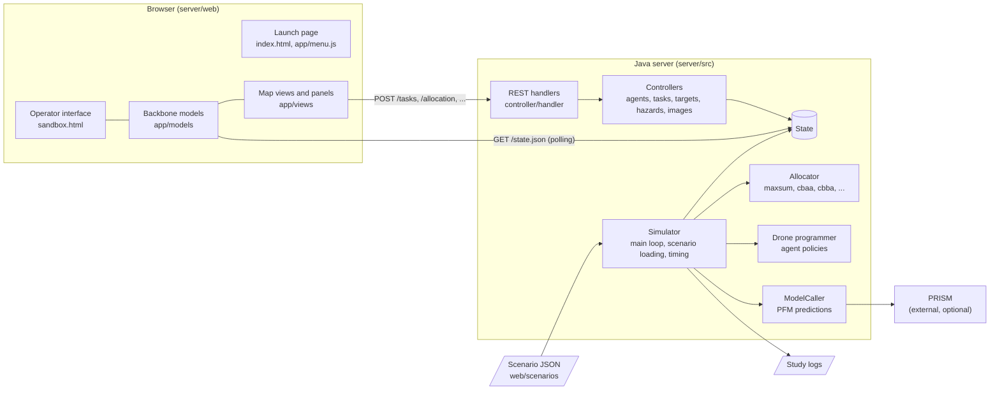

# Architecture

HARIS is a Java server that simulates the mission and a browser client that draws it on Google Maps. The server holds one in-memory state and advances it at a fixed tick rate. The browser polls that state as JSON and sends operator actions back as REST calls. There is no database and no build step for the client.



- [Server](#server)
- [Simulation loop and timing](#simulation-loop-and-timing)
- [Allocation](#allocation)
- [Agents](#agents)
- [The drone programmer](#the-drone-programmer)
- [Predictive fleet management](#predictive-fleet-management)
- [Browser client](#browser-client)
- [Looks, timing and replay](#looks-timing-and-replay)
- [Legacy parts](#legacy-parts)

## Server

The server is plain Java 21 with two dependencies (Gson and, for the legacy real-drone link, the RabbitMQ client). The HTTP server is the embedded [JLHTTP](https://www.freeutils.net/source/jlhttp/) in `tool/HttpServer.java`, so nothing else needs installing.

| Package | Contents |
|---|---|
| `server` | `Simulator` (entry point, main loop, scenario loading, timing), `Allocator`, `ModelCaller` and the older `Modeller` |
| `server.controller` | One controller per part of the state: `AgentController`, `TaskController`, `TargetController`, `HazardController`, `ImageController` (scan images), `MissionController` (dynamic task spawning), `ScoreController`, `ScoutingController` (the AAMAS 2023 scouting demo), `EpisodeController` (the swarm degradation study, with `EpisodeRecorder` for optional screen clips; LSL markers are in the `lsl` package). `ConnectionController` sets up the HTTP server and the REST handlers. |
| `server.controller.handler` | One REST handler per URL prefix (`/agents`, `/tasks`, `/allocation`, `/mode`, `/review`, `/ui`, ...), built on `RestHandler`. See the [REST API](api.md). |
| `server.model` | `State` and the model classes: `agents`, `task`, `target`, `hazard` |
| `server.model.agents.policies` | Drone programmer policies |
| `maxsum`, `cbaa`, `cbba` | Allocation algorithms |
| `verification` | `Model`: writes PRISM model files from templates and runs PRISM |
| `tool` | `HttpServer` (JLHTTP), `GsonUtils`, `MapsKey`, `ScenarioGenerator` |

`State` is the single source of truth. It holds the agents, tasks, targets, hazards, allocations, UI options, scores and timing, and is serialised whole to JSON for `GET /state.json`. Controllers change it; handlers translate HTTP requests into controller calls.

**Serving the client.** `ConnectionController` serves everything under `server/web/` as static files and routes REST paths to the handlers. As it serves an HTML page, it replaces the placeholder `%HARIS_MAPS_KEY%` with the key from `MapsKey`, so no key is ever stored in the repository.

**Scenarios.** `POST /mode/scenario` resets the state and calls `Simulator.loadScenarioFromFile`, which reads every field described in the [scenario reference](scenarios.md). `POST /mode/scenario/start` starts the clock.

## Simulation loop and timing

`Simulator.mainLoop` runs on its own thread. Each tick it advances simulated time by `1 / tickRate` seconds, steps every agent, checks the time limit, spawns tasks when a mission controller is set, runs the PFM once-per-second work, and sleeps so that the loop runs at `tickRate × speed` ticks per real second.

- **Tick rate** (default 10 Hz, 2 to 30 Hz) is how finely time is sliced. Movement, turning, battery drain, failure chances and communication timeouts are all scaled by the tick length (`Simulator.getTickFraction`), so behaviour per simulated second doesn't depend on it.
- **Speed** (×0.25 to ×8) is how many simulated seconds pass per real second.

Both can be changed at any time with `POST /mode/timing` (the sliders in the interface use it), and a scenario can set its starting `tickRate` and `simSpeed`. A scenario starts at ×0.5 unless it sets `simSpeed`; the study scenarios (degradation, resolution and PFM) set `"simSpeed": 1.0` so they run in real time, as in the studies.

When the time limit is reached, the mission stops, and if the scenario has a `nextScenarioFile` the server prepares it so the client can offer it next.

## Allocation

An allocation maps each agent to at most one task; several agents can share a task. The server keeps two allocations:

- the **main allocation**, which agents are carrying out, and
- a **temporary allocation**, which the operator edits in edit mode, with undo and redo.

Dragging from an agent to a task (`POST /allocation/allocate`) or pressing auto-allocate (`POST /allocation/auto-allocate`) changes the temporary allocation. Confirming (`POST /allocation/confirm`) copies it to the main allocation, and the agents set off.

`Allocator` runs the planner named by the scenario's `allocationMethod` (MaxSum by default; also saturated MaxSum, random, MaxSum with overspill, best-first, basic and heuristic bundles, CBAA, CBBA and CBBA coverage). The algorithms live in their own packages so another planner can be added without touching the rest of the server.

`allocationStyle` sets how much of this the operator does. With `manual` and `manualwithstop` the operator assigns or confirms (with `manualwithstop`, agents hold position while the operator edits). With `dynamic`, free agents are given the next task automatically, and the operator can still intervene. The heatmap interface adds `POST /allocation/groupAllocate`, which assigns a cluster of agents to a cluster of tasks at once.

### Tasks

| Type | Number | Behaviour |
|---|---|---|
| Waypoint | 0 | Go to a point; done on arrival. |
| Monitor | 1 | Go to a point and stay there until reassigned. |
| Patrol | 2 | Follow a closed path; several agents space themselves around it. |
| Region | 3 | Sweep a rectangle with a generated back-and-forth path. |
| Deep scan | 4 | A high-resolution scan of a possible target. |
| Shallow scan | 5 | A quick low-resolution scan. |
| Visit | 6 | A ground vehicle visit to a triaged target. |
| Ground | 7 | A task for ground vehicles. |

## Agents

All agents extend `server.model.agents.Agent`.

| Class | What it is |
|---|---|
| `AgentVirtual` | A simulated UAV driven by the central allocation. The common case. |
| `AgentProgrammed` | An agent whose behaviour comes from a drone programmer policy. Shown as a UGV in the triage scenario. |
| `AgentHub`, `AgentHubProgrammed` | The base station. The programmed hub relays tasks and information to programmed agents. |
| `AgentCommunicating` | A virtual agent that also exchanges messages like a programmed one, so manual and programmed agents can work together. |
| `AgentGhost` | Where the hub believes an agent to be, under communication limits. This is what the operator sees. |
| `AgentReal` | A real drone connected through the legacy Android controller. Not used in Moongazer; see [real drones and manual control](legacy/real-drones.md). |

## The drone programmer

Programmed agents run a **policy**: a class that extends `AgentProgrammer` and is called by the agent every tick. A policy only sees what the agent knows locally (its neighbours and the tasks it has heard about), and acts through a `ProgrammerHandler`, available as the field `a`.

```java
public class MyPolicy extends AgentProgrammer {
    public MyPolicy(ProgrammerHandler programmerHandler) { super(programmerHandler); }

    @Override public void setup() {
        // once, on this agent's first step
    }

    @Override public void step() {
        // every tick
        if (a.isStopped()) {
            List<Coordinate> task = a.getHighestPriorityNearestTask();
            if (task != null) { a.setTask(task); a.resume(); }
        } else {
            a.followRoute();
        }
    }

    @Override public void onComplete(Coordinate coords) { /* a task was completed */ }

    @Override public void onMessageReceived(String opCode, String payload) {
        // custom messages sent with a.sendCustomMessage(opCode, payload)
    }
}
```

Useful `ProgrammerHandler` calls include `setTask`, `followRoute`, `stop`, `resume`, `cancel`, `goHome`, `getNearestTask`, `getNearestEmptyTask`, `getHighestPriorityNearestTask`, `getNeighbours`, `getNeighbourPositions`, `calculateAverageNeighbourHeading`, `flockWithAttractionRepulsion` and `sendCustomMessage`. The neighbour and task information comes from messages, so it may be incomplete or out of date, which is the point under communication limits.

To add a policy:

1. Put the class in `server/src/server/model/agents/policies/`.
2. Add a `case` for its name in the `switch` in the `ProgrammerHandler` constructor.
3. Use it from a scenario: `{ "lat": ..., "lng": ..., "programmed": true, "policy": "MyPolicy" }`, with a `hub`.

`GenericAgentPolicy` (leader election, exploration and flocking) and `UseCasePolicy` (the triage ground vehicles) are working examples.

## Predictive fleet management

In a PFM mission (a scenario with `verificationParameters`), `ModelCaller` periodically turns the current mission into probabilistic models and asks PRISM how long it will take to finish:

1. It takes a snapshot of the current mission state.
2. `verification.Model` fills in the templates in `server/web/verification/` (`template_curr.txt`, `template_add1.txt`, `template_rem1.txt`) to make PRISM models of the swarm as it is, with one drone more and with one drone fewer, and checks them against `property.pctl` using `samples` simulation samples.
3. With `modelStyle: "parallel"` the three models run as three PRISM processes at once.
4. The results become the estimated completion times in `State`, which the client shows in the completion panel and on the add and remove buttons.

Models are re-run every `autoRunFrequency` simulated seconds and after every add or remove. In the placebo condition (`isDummy: true`), `Model.fakeCall` waits a random delay and returns a plausible random estimate instead of calling PRISM. PFM missions use the original study's movement and battery model (`legacyStudyPhysics`) so that new runs stay comparable with the published results.

PRISM is found through the `prism.home` system property (set from `PRISM_HOME` by `./gradlew run`), defaulting to `server/libs/prism-4.8`.

## Browser client

The client is the code the original HutSim interface was built on: jQuery 1.9, Backbone 0.9 and Underscore, with the Google Maps JavaScript API (pinned to v3.64), all vendored in `server/web/lib/`. There is no bundler; pages load scripts directly.

| Path | Contents |
|---|---|
| `index.html`, `app/menu.js` | The launch page: tiles from `showcase/showcase.json`, the scenario list, the look switch |
| `sandbox.html` | The operator interface for scenarios and the sandbox |
| `app/main.js` | Start-up and the polling loop that fetches `state.json` |
| `app/models/` | Backbone models and collections for the state, agents, tasks, targets, hazards and ghosts |
| `app/views/map.js`, `app/views/map/` | The map and one controller per thing drawn on it (agents, tasks, targets, hazards, heatmaps, images) |
| `app/views/` | Panels: review, prediction, camera, graphs |
| `app/timing.js` | The speed and tick rate sliders, and the polling interval |
| `app/replay.js` | Replay mode for recorded runs |
| `theme/` | Moongazer styles (`tokens.css`, `launch.css`, `sandbox.css`), the look switch (`look.js`) and the logo |
| `scenarios/` | Scenario files |
| `showcase/` | Launch page tiles and their images |
| `replays/` | Recorded runs for the online demo |
| `images/` | Scan images used by reviewable targets |
| `verification/` | PRISM model templates and property (generated models are git-ignored) |

The polling loop fetches `state.json`, updates the Backbone models, and the views redraw whatever changed. Operator actions are `$.post` calls to the REST API; their effect appears on the next poll.

## Looks, timing and replay

**Looks.** `theme/look.js` runs first in every page and picks the Modern or Classic look from `?look=` or the remembered choice. In Classic it disables the Moongazer stylesheets (`<link data-mg-theme>`) and hides Moongazer-only markup, so the interface is exactly the original one, and it sets the original 5 Hz tick rate and 400 ms polling.

**Replay.** `app/replay.js` installs a jQuery transport before the first state fetch. With `?replay=<id>`, it loads `replays/<id>.json.gz` and answers `state.json` from the recording, interpolating agent positions between frames, while other requests are accepted and ignored. Recordings are made by `tools/record_replay.py`. See [Showcase and demo](showcase.md#the-website-and-online-demo).

## Legacy parts

Some parts of the repository come from HutSim and are kept but not maintained:

| Path | What it is |
|---|---|
| `controller/` | The Android app that linked real DJI drones to the server over RabbitMQ |
| `server/src/server/QueueManager.java`, `AgentReal` | The server side of that link |
| `server/build.xml`, `server/hut.jar`, `server/jarFolder/`, `server/simulator.run/`, `server/hut-server.iml` | The old Ant/IntelliJ build and a prebuilt jar, replaced by Gradle |
| `server/libs/` | Jars from before Gradle, and an uninstalled PRISM 4.7 for Linux. The Gradle build doesn't use them. |
| `server/src/server/MultiSim.java`, `SimRunner.java` | An experiment in running several simulators in one JVM |
| `server/src/server/Modeller.java` | The earlier success-chance predictor based on precomputed tables |
| `server/Testing/` | An old Selenium web test |
| `server/web/scenarios/unusued/`, `Testing/` | Scenarios from past experiments and development |
| [`docs/legacy/real-drones.md`](legacy/real-drones.md) | What is known about the real-drone and manual-control code, for later |
